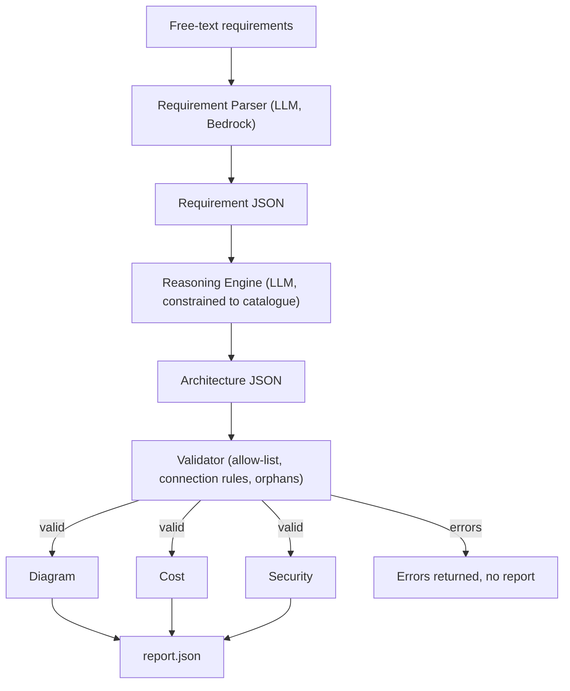

# Architecture

Recommendation-only: the system never deploys anything to AWS.

## Pipeline

## Modules (`src/aws_arch/`)
| Module | Responsibility | LLM? |
|---|---|---|
| `llm.py` | Bedrock wrapper + on-disk cache, JSON reply parsing | calls Bedrock |
| `parser.py` | text -> Requirement JSON (schema-checked, retry) | yes |
| `reasoner.py` | Requirement JSON -> Architecture JSON using only catalogue services | yes |
| `validator.py` | allow-list, allowed connections, orphan detection | no |
| `diagram.py` | render Architecture JSON | no |
| `cost.py` | monthly cost range from catalogue figures | no |
| `security.py` | rule checks mapped to Well-Architected pillars | no |
| `pipeline.py` | wires stages; `run_downstream` (no LLM) and `run_full` | no |
| `common.py` | paths, JSON/YAML loading, schema check | no |

LLM calls are allowed only in `parser.py` and `reasoner.py`.

## JSON contracts
Authoritative definitions live in `schemas/requirement.schema.json` and `schemas/architecture.schema.json`; samples in `examples/`. Do not duplicate field lists here; read the schemas.
- **Requirement JSON:** app type, users, traffic pattern, availability, storage, performance, compliance, budget sensitivity, assumptions.
- **Architecture JSON:** `pattern`, `services[{id,type,role,rationale}]`, `connections[{from,to}]`, `security_controls[]`, `assumptions[]`.
- **report.json:** `valid`, `services`, `cost`, `security`, `diagram_files`, `assumptions` (or `valid:false` + `errors`).

Changing a schema or `catalogue/catalogue.yaml` requires telling the other team member.
